# THE WAKERS — four designs for the model

*Model design, C1 (queue #411, ARCHITECTURE §8 note 679). **Status: the director chose B, the Peat Man** (the Director's
Inbox, `C1-waker-model`, 13 Oct 2026), **built as GDD §8's titan**: on two legs, at least three times the stand-in's size
(the director's gym note, App. F.5; below). The ending itself, its timings and its numbers are D1's (`wakers.md`, note 588; approved 9 Oct)
and don't change here. This page is only what gets up: four ways it could look, each blocked out at its real size
against the real train, in the five moments the ending turns on. The blockouts are `tools/models/concepts/wakers.py`;
nothing in them goes into the game.*

## What every design has to do

The brief from `wakers.md` and the director's words:

- **Gargantuan.** "A car is a mouthful." Every design here stands 25–35 m and is 40–55 m across. A 14.5 m car fits in
  its grip.
- **The land getting up.** "The shapes the crew took for hills settle and shift" (§2). It has to lie in the land before
  dawn and pass for part of it, and be earth-coloured when it stands.
- **Long-limbed enough to run down a train.** Its top speed is 26 m/s, faster than the engine flat out, so every design
  covers ground in long strides or by some other trick.
- **The catch, in first person.** `WakerLift` raises the held cars from the rear, each car's rear end 6 m (`Step`) over
  its front's, a ramp up into its grip. With three cars up, the rearmost hangs about 22 m above the rail. The model's
  mouth and hands have to be there, and they're what the crew in those cars see from closest.
- **It reads at a kilometre, against the dawn.** The first sight is from the rear car looking back down the line. It's
  a silhouette against the cold line low behind the train (`risen`, below). That shot decides more than any other.
- **The art direction** (GDD §29): silhouette tied to function, one clear body-language idea, corrupted not abstract,
  native to the line's land (`maritime-rules.md`: drumlins, bog, black spruce, granite, red Fundy mud). Unnerving when
  it's still. The GDD's premise: the Corruption "exaggerates whatever allows something to survive".

Each design is shown in five shots:
1. **Lying** before dawn, off the line among the drumlins.
2. **Risen:** on the line 330 m back, seen from the rear car against the dawn.
3. **The chase,** from the side.
4. **The catch:** `WakerLift`'s ramp of cars into its grip.
5. **A portrait,** with a car beside it for scale.

The cars' lit windows are people.

---

## A. The Drumlin: a hill on stilts

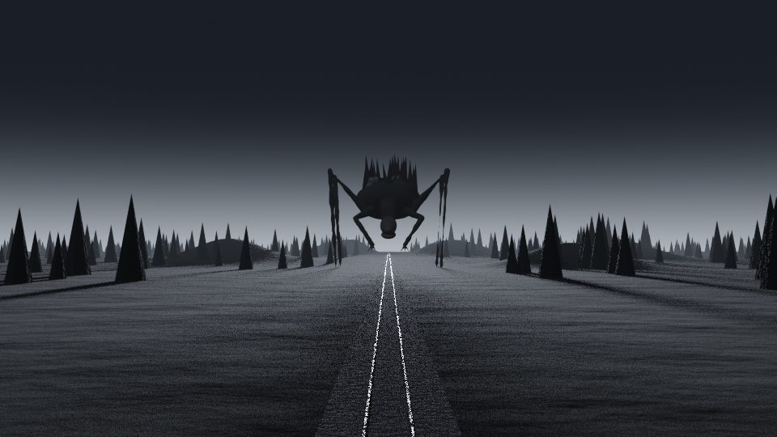

| Lying | The chase | The catch | Portrait |
|---|---|---|---|
| 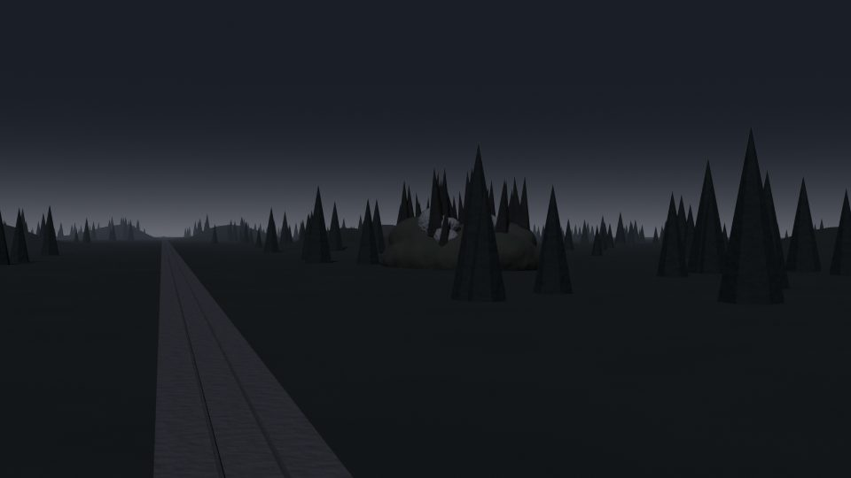 | 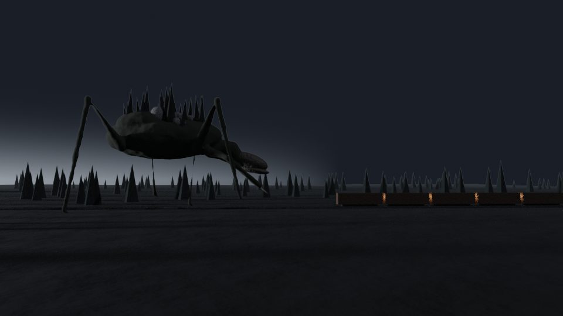 | 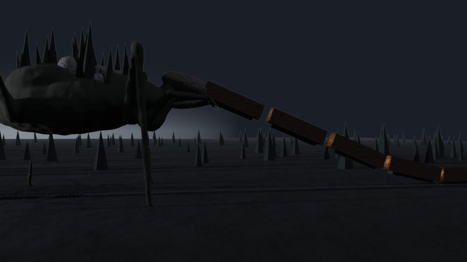 | 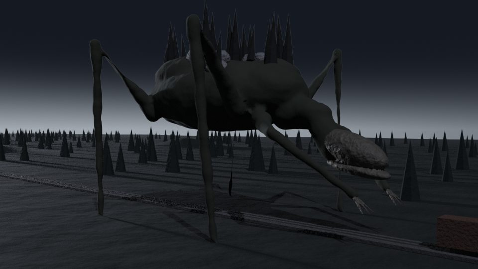 |

- **The idea.** It has lain still so long that its back became a drumlin: turf, dead spruce and granite erratics grown
  on it. Underneath are four long, thin legs whose knees kneel up above its back like a harvestman's. Its head hangs low
  under the front, bone-pale and peat-stained, with a jaw that drops open like a dredge's bucket. Either side of the
  head is a hooked arm, a sloth's, that takes the car.
- **Lying.** It lies as a hill among the hills, its legs folded under it and the spruce standing on its back. This is
  `wakers.md` §2 taken literally: "the hills move".
- **The rise.** The hill heaves up and the earth falls off it (the rise effect already throws the ground up). Then it
  stands on its knees, and the trees on its back sway.
- **The run.** A slow, long-legged lope with the knees pumping high over the back. The hill stays level as it comes, so
  from the rear car it looks like the horizon coming closer.
- **The catch.** The arms hook the rear car's sides, the jaw opens under it, and the cars go up into the head. From a
  lifted car you look down into the dredge's mouth and up at the underside of a hill.
- **At the walls.** It stands short of the guns and rears its front up, its knees high. The roar comes from under the
  hill.
- **Reads at a kilometre:** a hill on four stalks. Nothing else in the game has that outline.
- **Cost.** The skin plus separate trees and rocks on its back: about 22k triangles, 2048 atlas, a distance copy, and
  about 40 bones (four 3-joint legs, two arms, neck, jaw, a spine to bend the hill).
- **Risk:** its long thin legs could lose their read in the fog at a distance. Their knees are the read.

## B. The Peat Man: a bog body, crawling

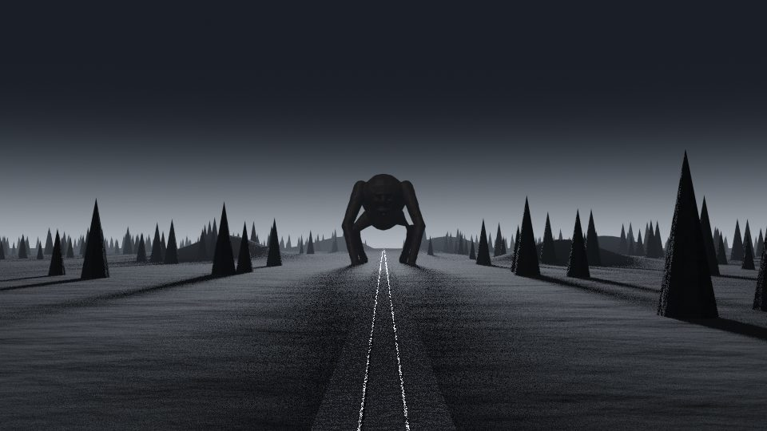

| Lying | The chase | The catch | Portrait |
|---|---|---|---|
| 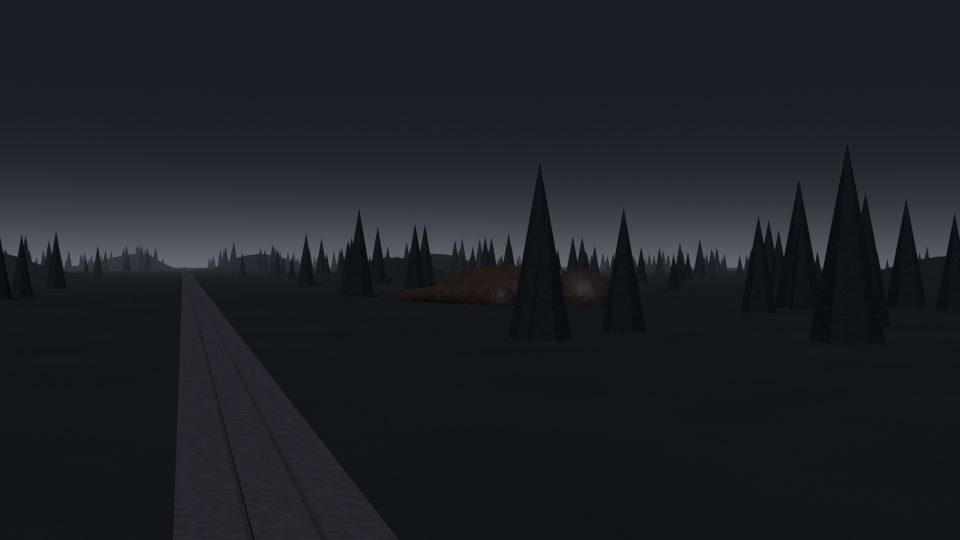 | 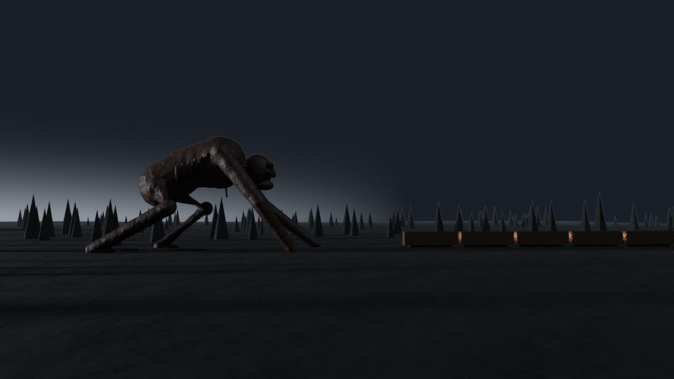 | 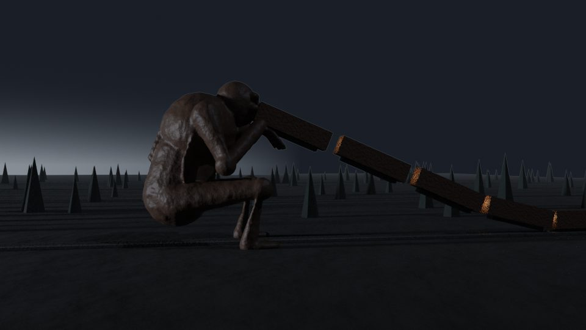 | 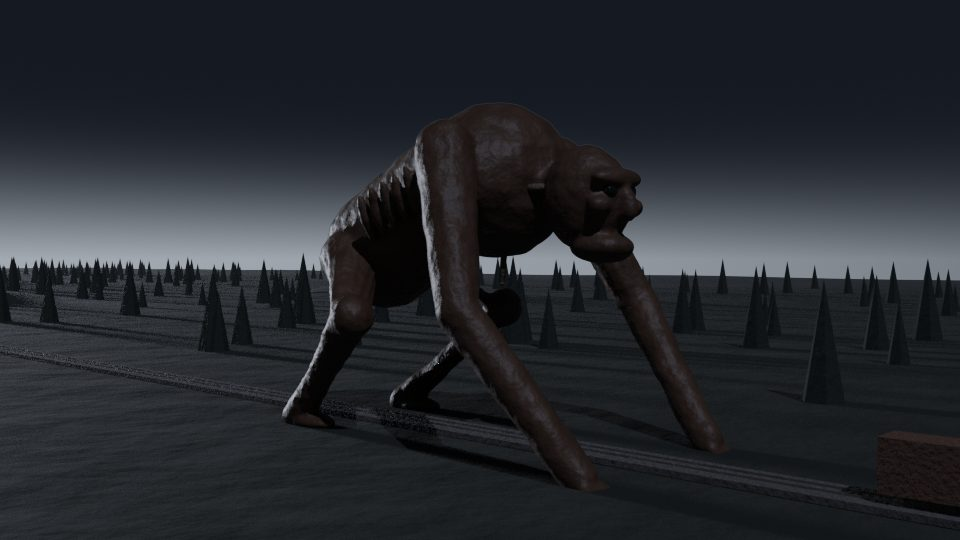 |

- **The idea.** A man who lay in the peat until it tanned him to leather. The Corruption grew him to the size of a hill.
  He is shrunk over long bones, with ribs and spine standing out, the rope still round his neck, and hair gone red with
  the bog. He runs bent double on his long arms, like an ape, and picks up the train in both hands like a child with a
  toy one, to his mouth. ("Humans became something stranger.")
- **Lying.** Face down in the land, half sunk. It reads as a long barrow with a spine down it and the back of a head at
  one end.
- **The rise.** He pushes himself up out of the ground on his arms, face first, the peat sliding off his back.
- **The run.** Knuckles and feet: arms swinging forward together, legs gathering under him. The gait is a gallop, so 26
  m/s fits it.
- **The catch.** He sits back on his heels with both hands round the rear car, and the cars go into his mouth end first.
  From a lifted car you see his face, close.
- **At the walls.** He crouches on his knuckles out of the guns' reach and howls, his jaw hanging.
- **Reads at a kilometre:** a man on all fours, too big. It's the most frightening of the four, and the catch is the
  clearest image of "picked up, with you in it".
- **Cost.** A humanoid rig (the crew's SK_Human, scaled, plus a jaw and fingers): about 18k triangles, 2048 atlas, a
  distance copy. The clips are the cheapest of the four, being built on a skeleton we already animate.
- **Risk:** it's less "the land getting up" than the others. The hills don't move; a body under them does. It's also the
  closest to the Climbers and the other corrupted humans.

## C. The Star-nose: a mole the size of a hill

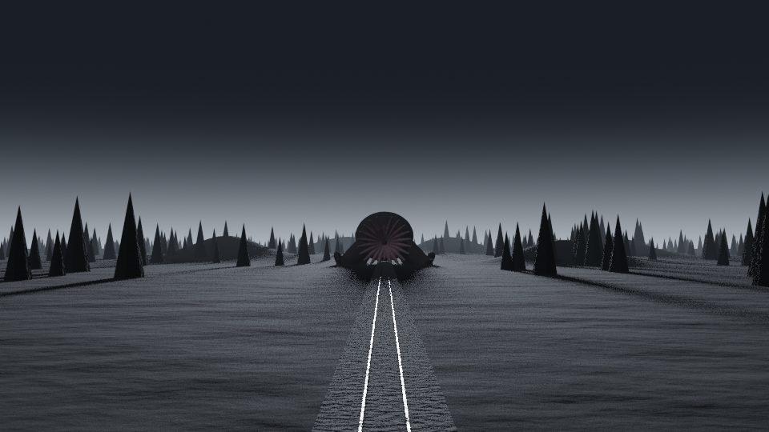

| Lying | The chase | The catch | Portrait |
|---|---|---|---|
| 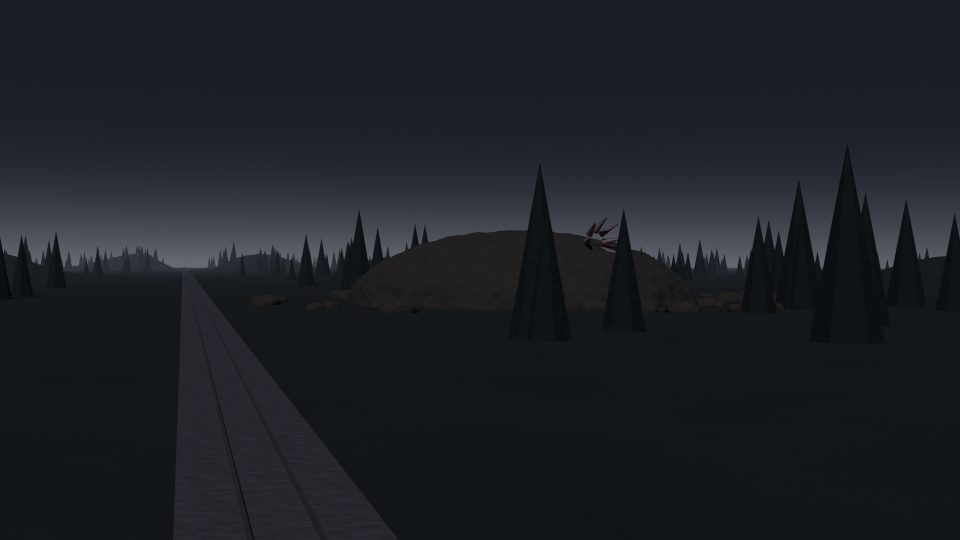 | 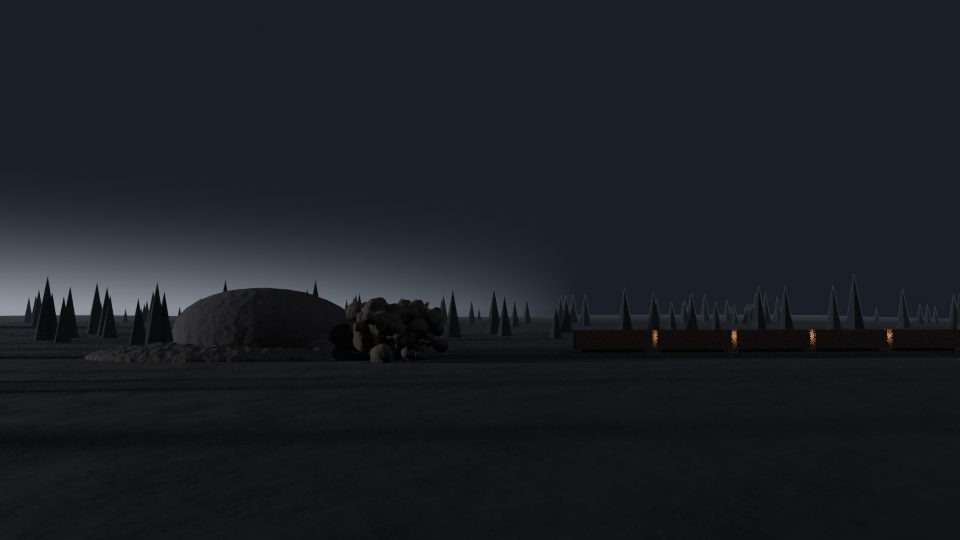 | 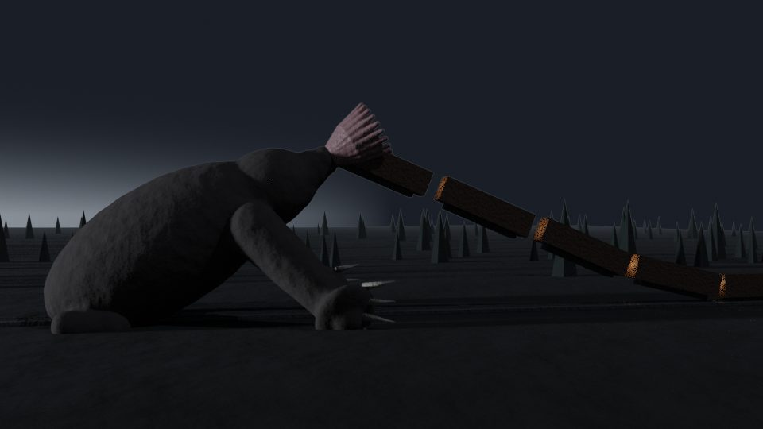 | 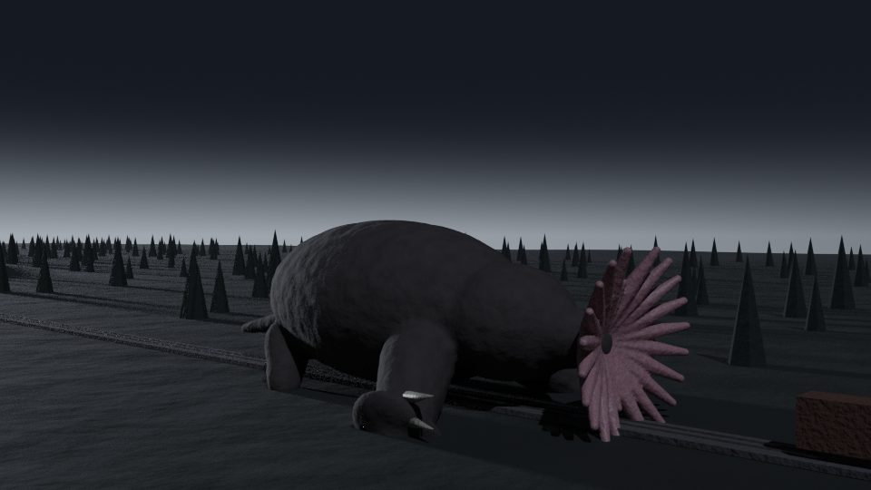 |

- **The idea.** The star-nosed mole is the Maritimes' own, a bog animal. This one is blind, with its velvet caked in mud.
  It doesn't run so much as swim the topsoil on its spade hands, throwing the land up in a bow wave. The twenty-two pink
  rays of its nose close round the last car like a hand round a worm. (The real one is the fastest eater there is: it
  finds and swallows a worm in a fifth of a second.)
- **Lying.** It lies under a molehill a hundred metres round, the tips of its star just showing.
- **The rise.** The molehill erupts, and the land heaves along the line toward the train.
- **The run.** Half under the ground, swimming, with a wave of earth and clods ahead of it the whole way. The chase shows
  as a furrow torn down the line after the train.
- **The catch.** It rears up on its spades, the star wraps the rear car and draws it in. From a lifted car you're held
  in the rays.
- **At the walls.** It stops short, sinks to its shoulders, and the star opens and shuts at the gate.
- **Reads at a kilometre:** a low hump and a moving bank of earth. This is the weakest silhouette against the dawn; the
  furrow is its read.
- **Cost.** About 16k triangles. The star is 22 rays with 3 bones each (66 bones), which makes the rig the heaviest of
  the four. The bow wave and furrow are effects work on top.
- **Risk:** it's the lowest of the four, so "gargantuan" is felt more from close than from the rear car. It's the most
  unusual of the four.

## D. The Snow Crab: legs fifty metres across

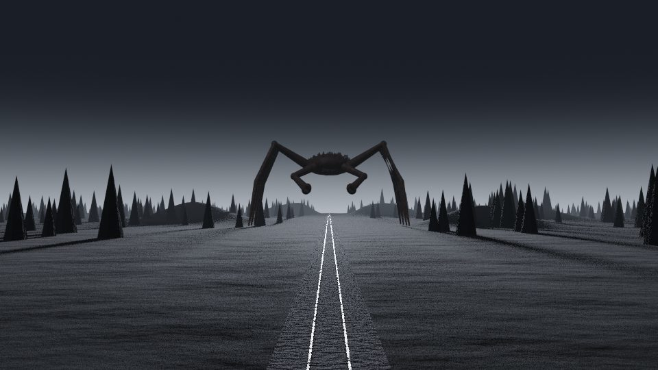

| Lying | The chase | The catch | Portrait |
|---|---|---|---|
| 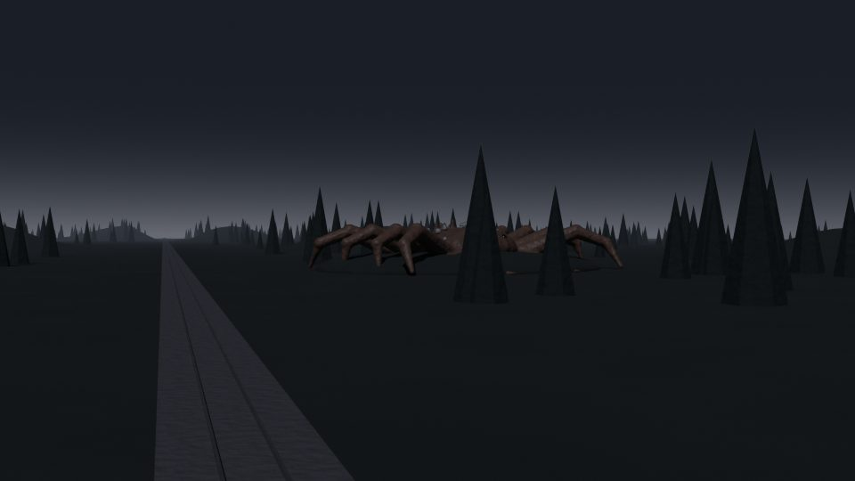 | 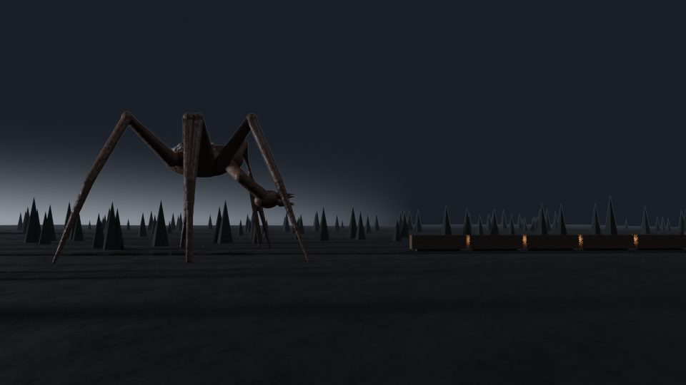 | 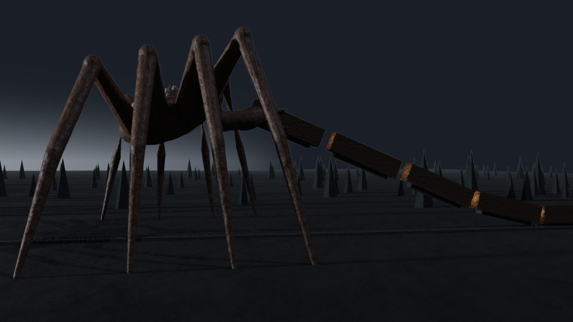 | 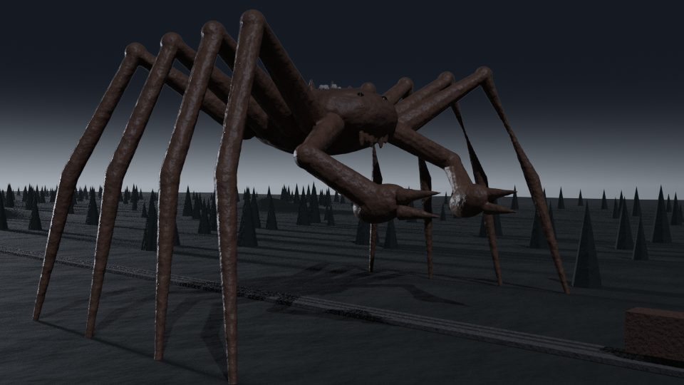 |

- **The idea.** The fishery's snow crab (legs ten times its body) come up out of the bog. Its carapace is like a granite
  boulder crusted with barnacles and peat. It holds eight walking legs high, fifty metres across, and moves them fast. It
  takes the car in two claws, to the mouthparts working under the front of its shell.
- **Lying.** Sunk in the bog to its shell's rim with its legs folded flat. It reads as a granite outcrop with something
  wrong about its shape.
- **The rise.** The legs unfold first, eight of them up out of the land, and then it lifts.
- **The run.** A crab's scuttle, forward rather than sideways: a forest of legs, very fast. It's the most obviously able
  to run down a train.
- **The catch.** The claws pinch the rear car's end and lift it to the mouthparts, which work at it.
- **At the walls.** It raises both claws over its shell (a crab's threat display) at the guns.
- **Reads at a kilometre:** a body slung between eight arches of leg. It's the clearest silhouette after the Drumlin.
- **Cost.** About 20k triangles. 8 legs × 4 joints plus 2 claws plus mouthparts makes about 50 bones.
- **Risk:** it's the most "monster movie" of the four, and the least human. Next to the Freight Beetle and the other
  many-legged creatures, a crab is one more arthropod.

---

## The director's choice: B, the Peat Man, a titan

The director chose **B** (the inbox, 13 Oct 2026). The same day, from the creature gym (GDD App. F.5, written into §8 as
"A titan"): "the waker is the right idea but it needs to be this large lumbering beast, at least 3 times as large as the
current model, it should be a biped titan type thing, the train should be struggling to outrun it because it has such a
large gait, not because it itself is fast."

So the Peat Man is built stood up, not crawling as in the blockout above:

- **On two legs, about 60 m tall.** That is three and a half times the stand-in's 17 m. A car is the length of his
  forearm. He walks hunched, his long arms hanging, his head pushed forward on the rope-galled neck.
- **Lumbering.** His top speed (26 m/s, `wakers.topSpeed`, unchanged) comes from his stride, not his cadence: each step
  is about as long as he is tall and takes about two seconds. His foot comes down, the ground shakes (the stir's thuds
  are his footfalls), and his weight rolls over it. The run's cycle is played at the Sim's speed, so his feet stay
  planted.
- **Lying.** He lies face down under the land, as in the blockout, only three times longer: a long barrow 80 m from head
  to heel, with a spine down it.
- **The rise.** He pushes himself up out of the ground on his arms, gets a knee under him, and stands. The peat slides
  off him (the rise effect).
- **The catch.** He drops to his knees astride the line behind the train, takes the rear car in both hands, and feeds
  the train to his mouth hand over hand. `WakerLift`'s ramp of cars runs up into his hands. From a lifted car you see
  his face, close.
- **At the walls.** He stands out of the guns' reach and howls, his jaw hanging.

### As built (queue #411, note 679)

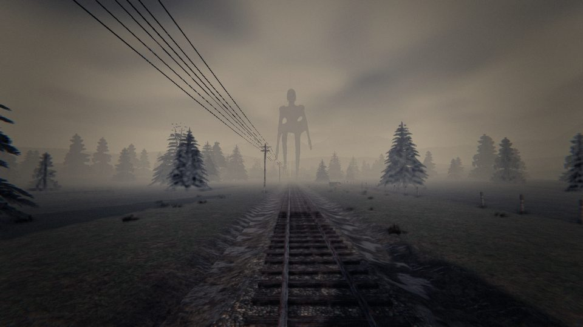

| The catch, close | From the next car up | At the walls |
|---|---|---|
| 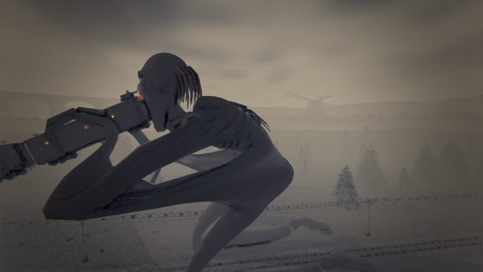 | 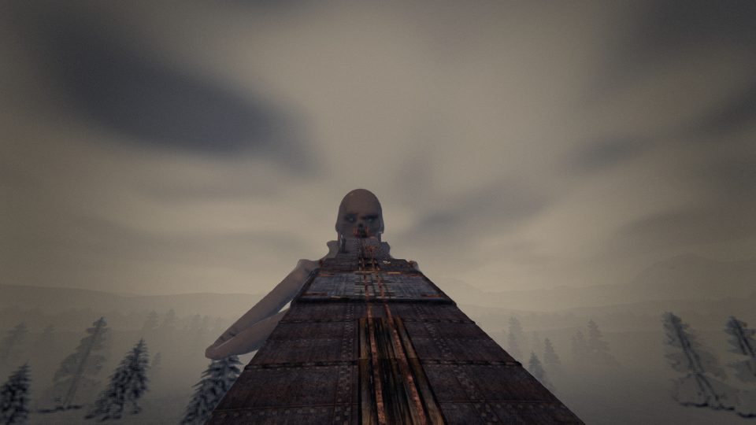 | 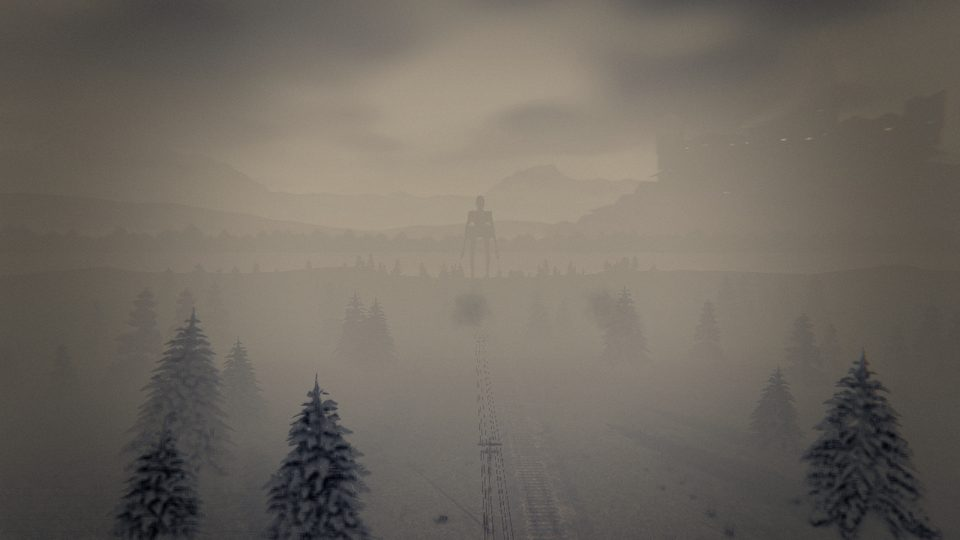 |

- **62 m stood** (`tools/blender/waker.py`, modelled 2.07 m and drawn 30 times that), on long legs, hunched, his arms
  hanging past his knees, the noose's end on his chest. About 11k triangles and a 2048 atlas, with a 3.9k distance copy.
- **His walk and his run** are blended by his speed and played at it. He walks below 12 m/s, a 24 m step every two
  seconds; at his top speed he runs, a 44 m step every 1.7 s. His feet stay where they come down. The dust they raise and
  the thuds through the train are the same footfalls.
- **The catch.** He's on his knees over the line, bowed so his mouth is on the car he's eating, wherever `WakerLift`'s
  ramp has it. He bites each car off a quarter at a time, four bites over the Sim's four seconds, the underframe and the
  trucks going with the rest, and his mouth goes on down it to the next car. `WakerLift` and the Sim are unchanged.

## C1's recommendation (before the choice)

**A, the Drumlin.** It is the design `wakers.md` already describes:
- the hills move;
- it reads as the land getting up;
- the existing rise effect (the ground heaving up and falling) is a hill rising.

From the rear car it's a hill on stalks against the dawn line, which nothing else in the game looks like. At the catch,
the train goes up into a hill. If the director wants the Peat Man's horror in it, the Drumlin's head can be his: a
leathered human face, too big, hanging under the hill. That's option **e** in the inbox.

## Building the chosen one (queue #411, after the director's choice)

1. **Model:** fused skin, baked atlas at 2048 (note 262's creature pass), and a distance copy for past 14 m. At these
   sizes, most of the time it's seen far off.
2. **Rig and clips:**
   - `lie`: the hill breathing in the stir;
   - `rise`: `riseSeconds`, 8 s;
   - `run`: its stride matched to 26 m/s;
   - `grab`;
   - `lift`: held, as the cars go up;
   - `eat`: a car every `eatSeconds`, 4 s;
   - `stand` and `roar` at the walls (`stopShort`).
3. **Drawn in place of `CreatureArt.WakerStandIn`.** Its grip and mouth are fitted to `WakerLift`'s ramp, with a test
   that the rear car's end is in its grip at the lift.
4. **Checked:** `dt screenshot --view waker|wakerlift|wakerinside|stir`, `dt art clip waker <clip>`,
   `CreatureArtTests`, and the Look Review.
